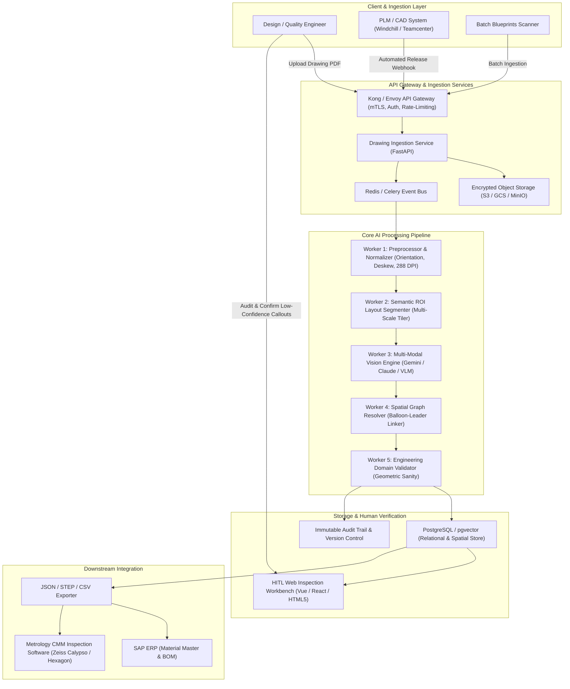
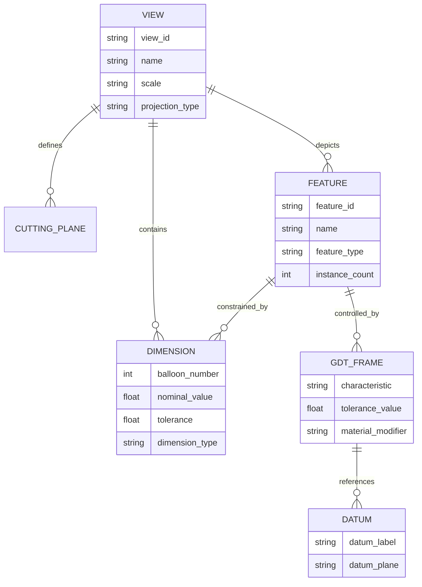
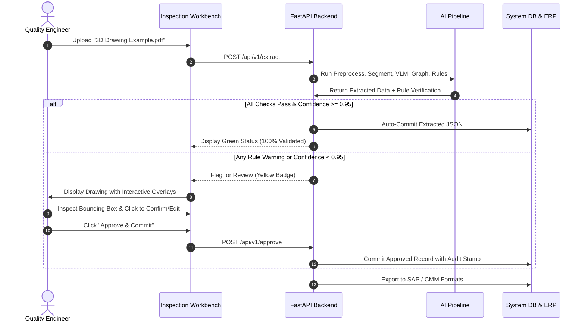

# Deliverable 2: System Architecture Design (End-to-End System Design)

**Project:** Automated Engineering Drawing Information Extraction Platform  
**Document ID:** JE-SYS-ARCH-2024-02  
**Target Enterprise:** Johnson Electric Engineering & Quality Operations  
**Classification:** Engineering Architecture Specification  

---

## 1. System Overview & Architecture Objectives

The objective of the system is to ingest complex 2D/3D technical engineering drawings in PDF/raster format, interpret their multi-view geometry, decode dense annotations, dimensions, and GD&T specifications, and export strongly-typed, mathematically validated structured records into enterprise PLM (PTC Windchill, Siemens Teamcenter), ERP (SAP), and Metrology/CMM quality systems.

### Key Architectural Tenets:
1. **Sub-Millimeter Fidelity:** Zero tolerance for hallucinated or transposed digits on critical dimensions.
2. **CAD-Agnostic Ingestion:** Robust handling of vector-flattened PDFs, scanned blueprints, rotated sheets, and mixed standards (ISO/DIN vs ASME).
3. **Traceable Grounding:** Every extracted dimension must have an interactive bounding-box coordinate linking it back to the original source PDF pixels.
4. **Active Human-in-the-Loop (HITL):** Seamless confidence-based escalation for human engineering approval.
5. **Air-Gapped / Private VPC Deployment:** Support for ITAR, NDA, and intellectual property confidentiality requirements.

---

## 2. End-to-End System Architecture (C4 Container Diagram)

The following Mermaid diagram outlines the container-level system architecture:

---

## 3. Detailed Component Decomposition

### 3.1. Ingestion & Preprocessing Subsystem
* **File Validation:** Validates MIME type, PDF version, security permissions, and page count.
* **Vector Stream Inspection:** Probes internal PDF objects for font tables vs raw Bézier paths (`m, l, c, S, f`).
* **Rasterization Engine:** Converts PDF pages into high-resolution PNGs at target 288 DPI using native vector rasterization to preserve sub-millimeter line edges.
* **Orientation & Deskewing Module:**
  - Evaluates drawing aspect ratio (standardizing to A0/A1 landscape).
  - Performs margin text orientation probing (e.g., detecting `"CONFIDENTIAL"` and title block location).
  - Rotates canvas by $0^\circ, 90^\circ, 180^\circ,$ or $270^\circ$ to establish standard landscape orientation where $(0,0)$ represents the top-left corner.

---

### 3.2. Semantic ROI Layout Analysis & Multi-Scale Tiling
* **Semantic Zoning:** Partitions the normalized drawing canvas into functional bounding boxes:
  1. `title_block`: Part ID, revision, company, author, drawing status, sheet count, format.
  2. `detail_views`: Magnified detail views (e.g., `Detail L (10:1)`, `Detail N (10:1)`).
  3. `section_views`: Section cuts (e.g., `Section M-M`, `Section W-W`, `Section T-T`).
  4. `coordinate_rails`: Coordinate dimensioning rails along X and Y axes (`600-699` series).
  5. `3d_visualization`: Isometric perspective rendering with brand logos (`saia-burgess`).
* **Context-Preserving Tiling:** Generates high-resolution cropped sub-images with 10% overlap margins to avoid cutting off witness lines or callout balloon tails.

---

### 3.3. Multi-Modal AI Extraction Engine
* **Model Orchestration:** Dispatches ROI crops in parallel to the multi-modal inference engine (e.g., Gemini 1.5/2.5 Pro or local enterprise Vision-LLMs).
* **Focused Engineering Prompts:** Uses domain-adapted prompts that instruct the model to parse:
  - Balloon tags (`<500>`, `<604>`, `<760>`, etc.)
  - Nominal values and tolerances (`±0.05`, `±0.1`, `±0.2`)
  - Dimension types (linear, angular, coordinate, diameter, radius, basic, reference)
  - Geometric tolerances and Feature Control Frames per ISO 1101
* **Structured Output Enforcement:** Employs JSON Schema / Pydantic validation to guarantee syntactically valid JSON output without markdown noise.

---

### 3.4. Spatial Entity Linking & Knowledge Graph Construction
* **Graph Architecture:** Constructs an engineering knowledge graph representing physical and functional relationships:
  - **View Nodes:** Represent projections and section cuts, tracking parent-child hierarchy (e.g., `Section M-M` is a child cut of `Detail L`).
  - **Feature Nodes:** Physical functional geometry (`Bore1-3`, `Snap1-4`, `Pin1-5`, `MountingEars`).
  - **Dimension Nodes:** Measured callouts with tolerances and balloon IDs.
  - **Datum Nodes:** Reference planes (`Datum Z`, `Datum X2`, `Datum Y2`, `Datum Z2`, `Datum Y3`).
* **Relationship Resolution:** Connects dimensions to their governing feature based on witness line endpoints, drawing series categorization (e.g., 500-series = Connector pins, 760-series = Snaps), and textual notes (*"Measured on bore 1-3"*).

---

### 3.5. Automated Engineering Verification & Domain Rule Engine
Before data is committed to the database or enterprise systems, it must pass a battery of automated mechanical engineering checks:

1. **Pilot Hole vs. Counterbore Invariant:**  
   $$\text{Diameter}_{\text{pilot}} < \text{Diameter}_{\text{counterbore}}$$  
   *(Verified: Pilot hole Ø2.6 mm < Counterbore Ø3.3 mm)*
2. **Grid Pitch Symmetry Invariant:**  
   $$|\text{Pitch}_{\text{Pin1}} - \text{Pitch}_{\text{Pin5}}| = 0 \quad \text{and} \quad |\text{Pitch}_{\text{Pin2}} - \text{Pitch}_{\text{Pin4}}| = 0$$  
   $$\text{Pitch}_{\text{outer}} = 2 \times \text{Pitch}_{\text{inner}} \quad (5.0\text{ mm} = 2 \times 2.5\text{ mm})$$
3. **Snap-Fit Retention Clearance Invariant:**  
   $$\text{Height}_{\text{snap\_window}} > \text{Height}_{\text{latch\_lip}} \quad (5.3\text{ mm} > 4.4\text{ mm})$$
4. **Tolerance Non-Negativity & Sanity Bounds:**  
   $$\forall d \in \text{Dimensions}, \quad \text{Tol}(d) > 0 \quad \text{and} \quad \text{Tol}(d) \le 0.1 \times \text{Nominal}(d) \text{ (unless general tolerance)}$$
5. **ISO 1101 GD&T Syntax Invariant:**  
   $$\text{GDT}_{\text{tolerance}} > 0 \quad \text{and} \quad |\text{Datums}| \ge 1$$

---

## 4. Human-in-the-Loop (HITL) Verification Workflow

To achieve 100% operational confidence in aerospace and automotive manufacturing, low-confidence extractions are automatically flagged for engineering verification:

---

## 5. Security, Compliance, & Non-Functional Requirements

### 5.1. Data Privacy & IP Confidentiality
- **Confidentiality Marking:** As identified in the drawing border (`CONFIDENTIAL`), technical drawings contain critical trade secrets and patentable geometry.
- **On-Premise / VPC Isolation:** The pipeline supports deployment inside an isolated VPC or air-gapped on-premise cluster with zero external egress.
- **Role-Based Access Control (RBAC):** Integrates with enterprise Single Sign-On (Okta / Azure AD / SAML) to restrict drawing access based on clearance and project assignment.
- **Data At Rest & In Transit:** Encrypted via AES-256 for storage and TLS 1.3 for all internal service communication.

### 5.2. Scalability & Performance Metrics
- **Throughput:** Capable of batch processing 500+ multi-page engineering drawing sets per hour using horizontal worker autoscaling on Kubernetes (KEDA).
- **Latency Target:** $< 8$ seconds per A0 sheet (with 8 parallel ROI workers).
- **Auditability:** Complete revision history tracked in PostgreSQL with cryptographic hash of original PDF and extracted JSON output.

